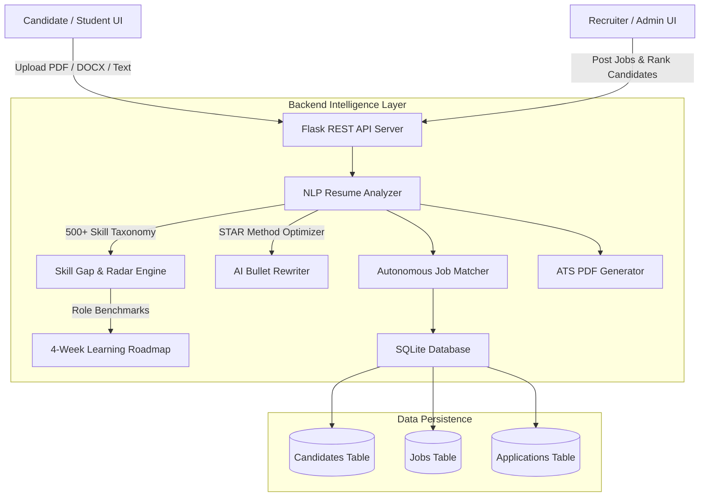

# ⚡ TalentLens AI — Next-Gen AI Resume Analyzer & Skill Gap Engine

> **Autonomous ATS Evaluation, Quantifiable Impact Scoring, Multi-Dimensional Skill Gap Radar, and Autonomous Job Match Engine for Freshers & Recruiters.**

Built for Hackathons & University Competitions.

---

## 🎯 Problem Statement
Fresh graduates and college students face an opaque recruitment barrier: **over 75% of resumes are rejected by Applicant Tracking Systems (ATS)** before reaching human recruiters. Freshers rarely know *why* their resume was rejected, what technical skills they are missing, how to rewrite weak project bullets, or which entry-level jobs actually match their existing competencies.

**TalentLens AI** bridges this gap by providing an end-to-end career intelligence engine that:
1. **Parses & Evaluates Resumes** across 4 key dimensions: ATS Formatting, Skill Density, Quantifiable Metrics & Action Verbs, and Readability.
2. **Identifies Skill Deficits** against top industry benchmark roles (Frontend, Backend, Full Stack, AI/Data Science, DevOps).
3. **Generates a Personalized 4-Week Skill Roadmap** with free curated resources (freeCodeCamp, React.dev, Kaggle, Docker Docs).
4. **Matches Freshers to Live Opportunities** with instant fit percentages and missing requirement alerts.
5. **Empowers Recruiters with an Admin Console** to post jobs, analyze applicant talent trends, and autonomously rank all candidates against any job opening using vector keyword overlap.

---

## 🏗️ Architecture & Technology Stack



### 📂 Isolated Module Architecture
The project is organized into completely separate code folders for clean modularity, distinct access levels, and maintenance:
* **`📁 user_module/`**: Independent candidate application (`index.html`, `login.html`, `css/style.css`, `js/app.js`, `js/api.js`, etc.). Features dedicated **🚪 Sign Out** button.
* **`📁 admin_module/`**: Dedicated administrator and recruiter application (`index.html`, `login.html`, `css/admin.css`, `js/admin.js`, `js/api.js`). Features dedicated **🚪 Admin Sign Out** button.
* **`📁 backend/`**: Python Flask REST API server, SQLite RBAC database (`resume_ai.db`), NLP parser, skill gap engine, and ReportLab PDF generator.

---

## 🔐 Authentication & Role-Based Access Control (RBAC)
Both modules enforce authentication and provide dedicated login credentials and session termination:

| Module | Code Folder | Access URL | Demo Email | Password | Role & Features | Logout Option |
|---|---|---|---|---|---|---|
| **🎓 Candidate / User** | `user_module/` | `http://localhost:5050/user` | `student@demo.com` | `student123` | ATS Scoring, Radar Gap Chart, 4-Week Roadmap, STAR Bullet Rewriter, Job Matches, PDF Resume | **🚪 Sign Out** button in nav bar |
| **🛡️ Administrator** | `admin_module/` | `http://localhost:5050/admin` | `admin@talentlens.ai` | `admin123` | Live Activity & Login Audit Stream, User Governance & Account Toggle, AI Candidate Ranker, Job Postings | **🚪 Admin Sign Out** button in nav bar |
| **🌐 Gateway Portal** | Root | `http://localhost:5050/` | - | - | Dual-module launchpad with direct links to both portals | - |

*(Note: Both login screens include 1-Click Demo Login buttons for instant access without manual typing).*

---

## 🚀 Quick Start (One Command)

### Prerequisites
- Python 3.8 or higher installed on your system.

### Running the Application
Clone or navigate to the project directory and run:

```bash
# Option 1: Using the bash runner script (Mac/Linux)
./run.sh

# Option 2: Using the python launcher directly
python3 start.py
```

The script will automatically set up the virtual environment, install dependencies, seed sample fresher profiles, start the backend on `http://localhost:5050`, and open your browser!

---

## 🌟 Key Features

### 👤 Candidate / Fresher Module
1. **Multi-Format Ingestion**: Drag & drop PDF/DOCX files, paste raw text, or load **1-Click Preset Profiles** (Priya Sharma - AI Intern, Rohit Verma - Backend, or Draft Resume - Needs Work).
2. **Real-Time ATS Score & Breakdown**:
   - SVG circular gauge showing overall ATS percentage (0-100%).
   - Detailed sub-scores: Structure, Skill Alignment, Quantifiable Impact, and Brevity.
3. **Actionable Feedback**: Instant green checkmarks for verified strengths and amber warnings for critical fixes (e.g. missing GitHub, low measurable metrics).
4. **Interactive Skill Gap Radar**: 5-axis dynamic canvas radar chart comparing candidate capabilities against industry standards.
5. **Curated 4-Week Learning Roadmap**: Weekly action items with direct links to free courses and project tutorials.
6. **AI STAR Resume Bullet Rewriter**: Transforms weak bullets like *"Worked on react website"* into high-impact STAR statements with metrics.
7. **Autonomous Job Matcher**: Browse matched openings with fit scores, view skill overlaps, and apply with 1 click.
8. **ATS-Compliant PDF Export**: Download a cleanly formatted, ATS-optimized PDF resume generated on the fly.

### 🛡️ Recruiter / Admin Module
1. **Talent Analytics Dashboard**: Track total evaluated resumes, average ATS score, and top in-demand skills vs top fresher skill gaps.
2. **Job Postings Manager**: Create and publish entry-level openings with required and preferred skills.
3. **Autonomous Candidate Ranking**: Select any job opening; the system instantly ranks all candidate resumes in the database by match percentage and displays missing prerequisites.

---

## 📡 API Reference

| Method | Endpoint | Description |
|---|---|---|
| `GET` | `/api/health` | Service health check |
| `POST` | `/api/analyze-resume` | Parse resume (File or JSON) & return ATS scores, skills, gaps, and job matches |
| `POST` | `/api/enhance-bullet` | Refactor weak resume bullet into 3 high-impact STAR statements |
| `GET` | `/api/jobs` | Retrieve all active job postings |
| `POST` | `/api/jobs/apply` | Record a candidate job application |
| `POST` | `/api/download-ats-pdf` | Generate and download ATS-compliant PDF resume |
| `GET` | `/api/admin/metrics` | Retrieve platform-wide candidate & skill gap statistics |
| `GET` | `/api/admin/candidates` | List all evaluated candidate resumes |
| `POST` | `/api/admin/jobs` | Post a new job opening |
| `DELETE` | `/api/admin/jobs/<id>` | Delete a job opening |
| `GET` | `/api/admin/rank/<job_id>` | Auto-rank all candidates against a specific job opening |

---

## 🧪 Testing with Demo Profiles
When presenting to judges or instructors, use the **⚡ Quick-Load Demo Profiles** tab:
- **Priya Sharma (Data Science Intern)**: Demonstrates PyTorch/ML skills and high match for Google Cloud AI role.
- **Rohit Verma (Junior Backend)**: Demonstrates Java/Spring Boot/Docker skills and high match for Razorpay.
- **Draft Resume Profile**: Demonstrates how the system flags weak action verbs, low brevity, missing links, and provides specific remediation steps.

---

## 🏆 Hackathon Submission Checklist
Refer to [`HACKATHON_SUBMISSION_GUIDE.md`](file:///Users/deepakboddanapalli/Ai%20Resume%20/HACKATHON_SUBMISSION_GUIDE.md) for the complete pitch deck outline, live demo presentation script, and judge Q&A defense.
